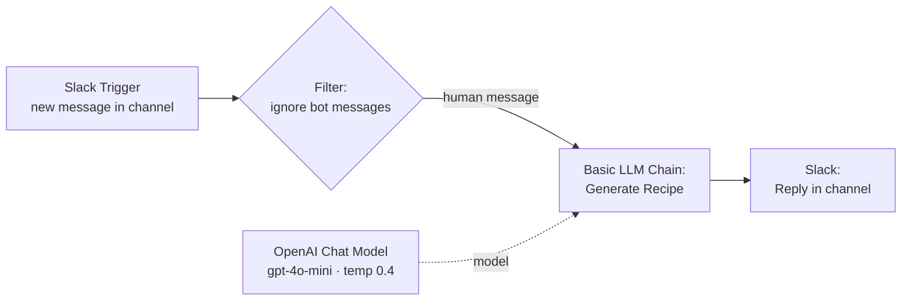

# 🍳 Slack Recipe Bot — n8n + OpenAI

A Slack bot built with n8n. When someone types a dish name in a channel, it replies with a complete, home-cook-friendly recipe. The reply includes ingredients, equipment, timed steps, tips, substitutes and serving suggestions, all formatted for Slack.


---

## ✨ What it does

1. Listens for new messages in a Slack channel (`#n8n-automation`).
2. Ignores messages from bots, system or edited messages, and messages with no text.
3. Removes user mentions (`<@U123…>`) and sends the text to **gpt-4o-mini**.
4. The model works out which dish is meant, even from a full sentence or a misspelling. For example, *"Hi, give me a receipe for panner tikka"* becomes **Paneer Tikka**.
5. It posts the recipe back to the channel using Slack's own formatting (mrkdwn).

### Smart handling

| Input | Bot behaviour |
|---|---|
| `paneer butter masala` | Full recipe for 4 servings |
| `chicken biryani for 6, less spicy` | Adjusts the servings and spice level |
| `hi` | Asks the user to type a dish name |
| An ambiguous dish name | Suggests 2–3 close matches and asks which one |
| Meat, egg or seafood dishes | Adds food-safety notes |

### Sample reply

```
🍽️ *Paneer Tikka* _(North Indian / Punjabi)_
Smoky, spiced paneer cubes grilled with peppers and onions.

⏱️ *Prep:* 20 min  |  *Cook:* 15 min  |  *Total:* 35 min
👥 *Serves:* 4  |  📊 *Difficulty:* Easy

🛒 *Ingredients*
_For the marinade_
• 200 g (¾ cup) thick curd – hung curd works best
• 1 tbsp ginger-garlic paste
...

👩‍🍳 *Method*
1. Whisk the marinade ingredients together _(5 min)_
...

💡 *Tips & substitutes*
• No oven? Use a hot tawa or grill pan.

🍛 *Serve with:* Mint chutney, sliced onions, lemon wedges
```

---

## 🔀 Workflow



| Node | Type | Purpose |
|---|---|---|
| Slack Trigger | Slack Trigger | Fires on every new message in `#n8n-automation` |
| Ignore bot messages | Filter | Passes a message only when `bot_id` is missing, `subtype` is missing and `text` is not empty. This stops the bot from replying to itself |
| Generate Recipe | Basic LLM Chain | Strips mentions and applies the chef system prompt and recipe template |
| OpenAI Chat Model | LangChain LLM | `gpt-4o-mini`, temperature `0.4` (consistent output), max `1500` tokens |
| Reply in Slack channel | Slack | Posts the generated recipe (`$json.text`) to the same channel |

---

## ⚙️ Setup

### Prerequisites
- An n8n instance reachable from the internet (n8n Cloud, or self-hosted behind a public URL or tunnel)
- A Slack workspace where you can create apps
- An OpenAI API key

### 1. Create the Slack app
1. Go to <https://api.slack.com/apps> → **Create New App**.
2. Under **OAuth & Permissions**, add these bot scopes: `channels:history`, `channels:read`, `chat:write`.
3. Install the app to your workspace and invite it to the channel: `/invite @YourBotName`.

### 2. Import the workflow
1. In n8n, go to **Workflows → Import from File** and select `Slack Recipe Bot.json`.
2. Add credentials:
   - **Slack API** (bot token): assign it to *Slack Trigger*.
   - **Slack OAuth2**: assign it to *Reply in Slack channel*.
   - **OpenAI**: assign it to *OpenAI Chat Model*.
3. In both Slack nodes, select your own channel. The channel ID in the export is specific to my workspace.

### 3. Connect Slack events to n8n
1. Open the *Slack Trigger* node and copy its **Production URL**.
2. In the Slack app, go to **Event Subscriptions**, turn it on, and paste the URL as the Request URL.
3. Under **Subscribe to bot events**, add `message.channels`.
4. **Activate** the workflow in n8n, then type a dish name in the channel.

---

## 🛠️ Customisation

| Want to… | Change |
|---|---|
| Reply in a thread instead of the channel | In *Reply in Slack channel* → Options, add **Thread TS** = `{{ $('Slack Trigger').item.json.ts }}` |
| Change the default servings or cuisine | Edit the **RULES** section of the system prompt |
| Get longer or more creative recipes | Increase `maxTokens` or raise `temperature` |
| Use a different channel | Update the channel in both Slack nodes |
| Use a different model | Change the model in *OpenAI Chat Model* |

---

## ⚠️ Known limitations

- **Replies go to the main channel, not a thread.** In a busy channel, recipes can get mixed up with other messages. See the thread option above.
- **Possible reply loop.** The reply node uses OAuth2. If that token posts *as a user* rather than as the bot, the reply has no `bot_id`, and the trigger may pick it up as a new request. Use a **bot token** for replying, or also filter out the bot's own user ID.
- **Every message triggers it.** Any human message in the channel triggers the bot, so use a dedicated channel.
- **Two slightly different "not a dish" replies.** The system prompt defines two fallback messages, one with an emoji and one without. Merging them would make replies consistent.
- **AI-generated recipes.** Quantities and timings are usually sensible, but they aren't verified by a chef.

---

## 📚 Learnings

Built as part of my GenAI and automation learning. It covers:
- Event-driven Slack bots with n8n triggers and loop-safe filtering
- **Basic LLM Chain** with a structured system prompt and an output template
- Prompt rules for tolerant input (typos, full sentences) and strict, channel-specific output formatting (Slack mrkdwn)

---

**Author:** [Dineshkumar Palanisamy](https://www.linkedin.com/in/pdineshkumar55) · [GitHub](https://github.com/pdineshkumar55)
